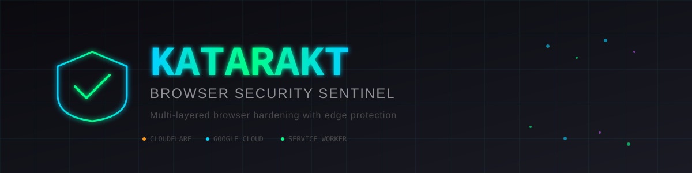
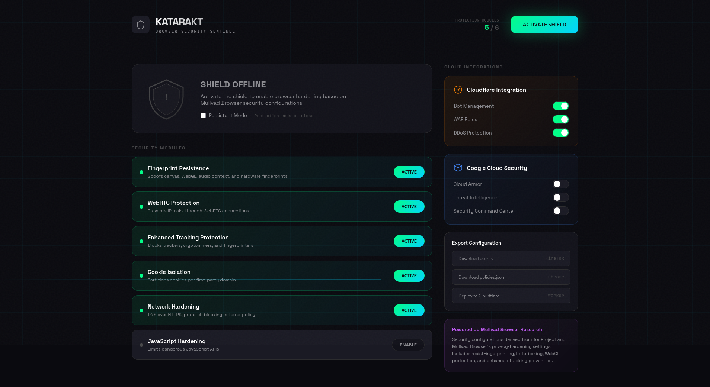
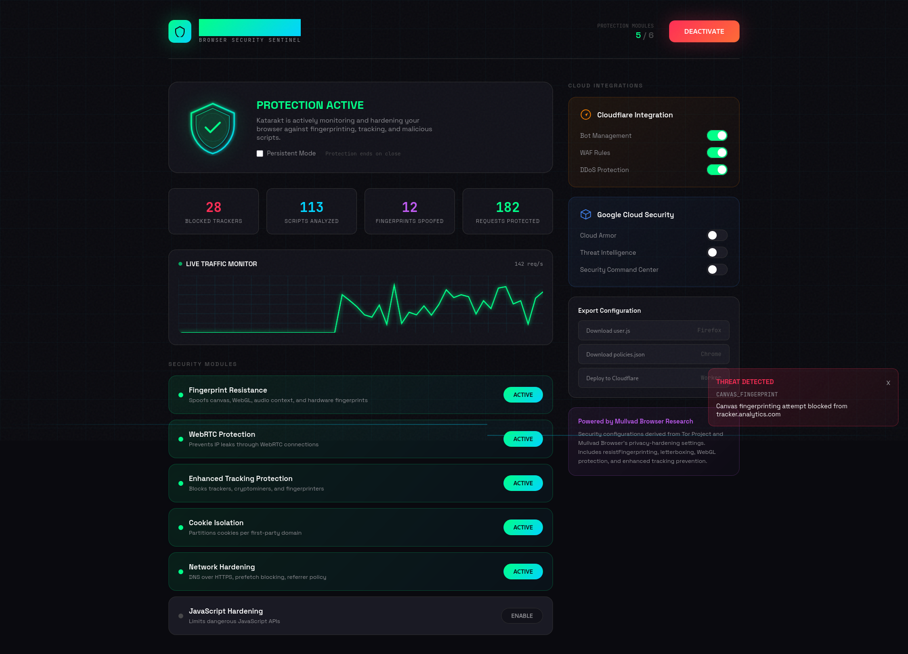
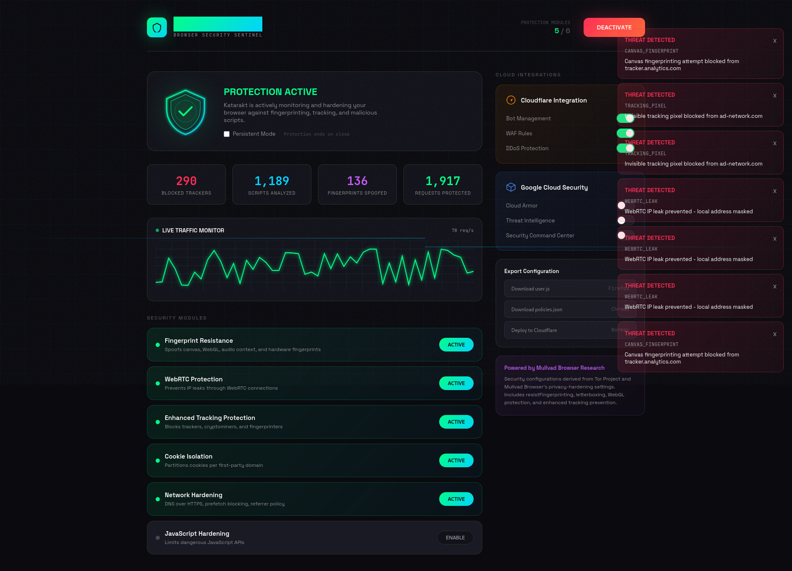

<div align="center">

# KATARAKT



## Browser Security Sentinel

[](https://opensource.org/licenses/MIT)
[](https://workers.cloudflare.com/)
[](https://cloud.google.com/run)
[](https://developer.mozilla.org/en-US/docs/Web/API/Service_Worker_API)
[](https://github.com/NubleX/katarakt)
[](https://github.com/NubleX/katarakt/pulls)

</div>

---

A comprehensive browser hardening solution that hardens stays with your browser even after you leave idarti.com
Inspired by Mullvad Browser's privacy-first approach, Katarakt provides multi-layered protection through client-side service workers and edge security on Cloudflare and Google Cloud.

## Table of Contents

- [Architecture](#architecture)
- [Screenshots](#screenshots)
- [Features](#features)
- [Quick Start](#quick-start)
- [Configuration Export](#configuration-export)
- [API Endpoints](#api-endpoints)
- [Mullvad Browser Alignment](#mullvad-browser-alignment)
- [Development](#development)
- [Contributing](#contributing)
- [License](#license)
- [Support the Project](#support-the-project)

---

## Architecture

``` bash
┌─────────────────────────────────────────────────────────────────┐
│                         USER BROWSER                            │
│  ┌─────────────────────────────────────────────────────────┐    │
│  │              Katarakt Service Worker                    │    │
│  │  ┌──────────┐ ┌──────────┐ ┌──────────┐ ┌──────────┐    │    │
│  │  │Fingerprin│ │  WebRTC  │ │ Tracker  │ │  Script  │    │    │
│  │  │Protection│ │  Block   │ │ Blocker  │ │ Analyzer │    │    │
│  │  └──────────┘ └──────────┘ └──────────┘ └──────────┘    │    │
│  └─────────────────────────────────────────────────────────┘    │
└─────────────────────────────────────────────────────────────────┘
                              │
                              ▼
┌─────────────────────────────────────────────────────────────────┐
│                    CLOUDFLARE EDGE                              │
│  ┌─────────────────────────────────────────────────────────┐    │
│  │              Katarakt Edge Worker                       │    │
│  │  ┌──────────┐ ┌──────────┐ ┌──────────┐ ┌──────────┐    │    │
│  │  │   Bot    │ │   WAF    │ │   DDoS   │ │  Header  │    │    │
│  │  │Detection │ │  Rules   │ │ Protect  │ │ Hardening│    │    │
│  │  └──────────┘ └──────────┘ └──────────┘ └──────────┘    │    │
│  └─────────────────────────────────────────────────────────┘    │
└─────────────────────────────────────────────────────────────────┘
                              │
                              ▼
┌─────────────────────────────────────────────────────────────────┐
│                   GOOGLE CLOUD BACKEND                          │
│  ┌─────────────┐ ┌─────────────┐ ┌─────────────────────────┐    │
│  │ Cloud Armor │ │  Threat     │ │ Security Command Center │    │
│  │   Policy    │ │Intelligence │ │     (Monitoring)        │    │
│  └─────────────┘ └─────────────┘ └─────────────────────────┘    │
└─────────────────────────────────────────────────────────────────┘
```

## Screenshots

<div align="center">

### Dashboard Interface



*Main dashboard showing protection modules and security status*

<br/>



*Real-time threat monitoring with live activity graph*

<br/>



*Comprehensive security statistics and threat logs*

</div>

---

## Features

### Client-Side Protection (Service Worker)

- **Fingerprint Resistance**: Spoofs canvas, WebGL, audio context, and hardware signatures
- **WebRTC Leak Prevention**: Blocks local IP address exposure
- **Tracker Blocking**: Blocks 100+ known tracking domains
- **Cryptominer Detection**: Identifies and blocks browser-based mining scripts
- **HTTPS Enforcement**: Automatic upgrade of insecure connections
- **Referrer Sanitization**: Limits cross-origin referrer data
- **Script Analysis**: Real-time detection of malicious JavaScript patterns

### Fingerprint Vectors Protected

<div align="center">

| Vector           | Protection Method                                      |
|------------------|--------------------------------------------------------|
| Canvas           | Noise injection + getImageData spoofing                |
| WebGL            | Parameter spoofing + readPixels blocking               |
| Audio            | Oscillator/Analyser interception                       |
| Navigator        | hardwareConcurrency, deviceMemory, platform normalized |
| Plugins          | Empty array returned,                                  |
| Screen           | Resolution/colorDepth normalized,                      |
| Timezone         | UTC spoofing                                           |
| Battery          | API blocked                                            |
| Network Info     | API blocked                                            |
| Performance.now  | Precision reduced (Spectre mitigation)                 |
| Text Metrics     | Values rounded                                         |
| ClientRects      | Values rounded                                         |
| Speech Synthesis | getVoices returns empty                                |

</div>

### Edge Protection (Cloudflare Worker)

- **Bot Detection**: Multi-signal bot identification and blocking
- **Security Headers**: Comprehensive header hardening (CSP, HSTS, X-Frame-Options)
- **Request Filtering**: Blocks requests to known malicious endpoints
- **DDoS Mitigation**: Rate limiting and challenge pages
- **Fingerprint Injection**: Adds client-side fingerprint protection scripts

### Cloud Backend (Google Cloud)

- **Cloud Armor**: WAF rules and DDoS protection
- **Threat Intelligence**: Real-time threat feed integration
- **Security Command Center**: Centralized monitoring and alerting
- **Audit Logging**: Complete request audit trail

## Security Modules

<div align="center">

| Module         | Description                         | Default  |
|--------        |-------------------------------------|----------|
| Fingerprinting | Spoofs browser fingerprint vectors  | Enabled  |
| WebRTC         | Prevents IP leak through WebRTC     | Enabled  |
| Tracking       | Blocks known trackers and analytics | Enabled  |
| Cookies        | Partitions cookies per first-party  | Enabled  |
| Network        | DNS-over-HTTPS, referrer hardening  | Enabled  |
| JavaScript     | Limits dangerous browser APIs       | Disabled*|

*JavaScript hardening may break some sites; enable with caution.

</div>

## Quick Start

### 1. Deploy to Cloudflare Workers

```bash
# Install wrangler CLI
npm install -g wrangler

# Login to Cloudflare
wrangler login

# Deploy the worker
cd katarakt
wrangler deploy
```

### 2. Configure DNS (optional)

Point your domain to the Cloudflare Worker:

``` txt
security.yourdomain.com -> katarakt-security.workers.dev
```

### 3. Deploy Backend to Google Cloud Run

```bash
# Build container
docker build -t gcr.io/PROJECT_ID/katarakt-backend .

# Push to registry
docker push gcr.io/PROJECT_ID/katarakt-backend

# Deploy to Cloud Run
gcloud run services replace google-cloud-run.yaml
```

### 4. Serve the Frontend

The `index.html` can be served from:

- Cloudflare Pages
- Google Cloud Storage + CDN
- Any static hosting service

## Configuration Export

Katarakt can export browser hardening configurations:

### Firefox (user.js)

```bash
curl https://your-worker.workers.dev/api/export/userjs > user.js
```

Place in your Firefox profile directory.

### Chrome (Policies)

```bash
curl https://your-worker.workers.dev/api/export/policies > policies.json
```

Deploy via enterprise management or manually.

## API Endpoints

<div align="center">

| Endpoint              | Method | Description            |
|-----------------------|--------|------------------------|
| `/api/health`         | GET    | Health check           |
| `/api/status`         | GET    | What this Worker applies (headers, CSP, script injection, bot blocking on/off) |
| `/api/export/userjs`  | GET    | Export Firefox config  |
| `/api/export/policies`| GET    | Export Chrome policies |
| `/api/report`         | POST   | Submit threat report (JSON, max 8 KiB, fixed schema) |

</div>

## Bot blocking (opt-in)

Request-header bot blocking is off by default. Set `BOT_BLOCKING = "on"` in `wrangler.toml` to return 403 for
requests with automated-looking User-Agents or missing `Accept-Language` / `Accept-Encoding`. The heuristics are
easy to evade and will also block curl, wget and privacy browsers that strip headers.

## Security Headers Applied

``` txt
X-Content-Type-Options: nosniff
X-Frame-Options: SAMEORIGIN
X-XSS-Protection: 0
Referrer-Policy: strict-origin-when-cross-origin
Permissions-Policy: geolocation=(), microphone=(), camera=()
Cross-Origin-Opener-Policy: same-origin
Cross-Origin-Embedder-Policy: require-corp
Cross-Origin-Resource-Policy: same-origin
Content-Security-Policy: [comprehensive policy]
```

## Mullvad Browser Alignment

Katarakt implements security settings directly from the Tor Browser / Mullvad Browser source code review (gitlab.torproject.org issue #40783). Key configurations include:

### Core Fingerprinting Protection

``` txt
privacy.resistFingerprinting: true
privacy.resistFingerprinting.letterboxing: true
privacy.firstparty.isolate: true
```

### Network Hardening

``` txt
network.dns.disablePrefetch: true
network.dns.disablePrefetchFromHTTPS: true
network.predictor.enabled: false
network.proxy.allow_bypass: false
network.trr.mode: 3 (DNS-over-HTTPS only)
network.http.http3.enabled: false
```

### WebRTC IP Leak Prevention

``` txt
media.peerconnection.enabled: false
media.peerconnection.ice.default_address_only: true
media.peerconnection.ice.no_host: true
```

### DOM/JavaScript Restrictions

``` txt
dom.enable_resource_timing: false
dom.enable_event_timing: false
dom.netinfo.enabled: false
dom.battery.enabled: false
dom.vr.enabled: false
dom.webaudio.enabled: false
dom.webmidi.enabled: false
```

### Text Metrics & Canvas Protection

``` txt
dom.textMetrics.actualBoundingBox.enabled: false
dom.textMetrics.baselines.enabled: false
gfx.offscreencanvas.domain-enabled: false
```

### Complete Telemetry Disable

``` txt
toolkit.telemetry.enabled: false
toolkit.telemetry.unified: false
toolkit.telemetry.archive.enabled: false
datareporting.healthreport.uploadEnabled: false
app.shield.optoutstudies.enabled: false
messaging-system.rsexperimentloader.enabled: false
```

### Cookie Isolation (Total Cookie Protection / dFPI)

``` txt
network.cookie.cookieBehavior: 5
privacy.partition.network_state: true
privacy.partition.serviceWorkers: true
```

### TLS/SSL Hardening

``` txt
security.ssl.require_safe_negotiation: true
security.ssl.enable_false_start: false
security.cert_pinning.enforcement_level: 2
```

The full configuration exports 150+ hardened preferences aligned with the Tor Project's privacy research.

## Persistent Mode

When enabled, the service worker continues monitoring even after the page closes:

- Maintains protection across tabs
- Tracks cumulative statistics
- Sends periodic threat reports
- Can be disabled at any time

## Privacy Notice

Katarakt is designed with privacy as a core principle:

- No personal data collection
- No third-party analytics
- Threat reports contain only aggregate statistics
- All processing happens locally or on your own infrastructure

## Development

```bash
# Local development with wrangler
wrangler dev

# Run the frontend locally
npx serve .

# Test the service worker
# Open Chrome DevTools > Application > Service Workers
```

## File Structure

``` bash
katarakt/
├── index.html           # Main SPA dashboard
├── cloudflare-worker.js # Edge security worker
├── katarakt-worker.js   # Browser service worker
├── wrangler.toml        # Cloudflare deployment config
├── google-cloud-run.yaml # GCP deployment config
└── README.md            # This file
```

## Contributing

Contributions welcome! Areas of interest:

- Additional fingerprinting vectors to protect
- New tracker/cryptominer patterns
- Browser-specific optimizations
- Mobile browser support
- Integration with additional cloud providers

## License

MIT License - Use freely, protect the web.

## Credits

- Security configurations inspired by [Mullvad Browser](https://mullvad.net/browser)
- Tor Project's research on browser fingerprinting
- Cloudflare Workers platform
- Google Cloud Security infrastructure

---

<div align="center">

**Katarakt** - Bringing strength to DOM, one request at a time.

``` txt
    ▄▄▄▄▄▄▄▄▄▄▄▄▄▄▄▄▄▄▄▄▄▄▄▄▄▄▄▄▄▄▄
   █                               █
   █   "In the flood of data,      █
   █    we are the cataract        █
   █    that filters evil."        █
   █                               █
    ▀▀▀▀▀▀▀▀▀▀▀▀▀▀▀▀▀▀▀▀▀▀▀▀▀▀▀▀▀▀▀
```

</div>

---

## Support the Project

If you find Katarakt useful, consider supporting its development:

<div align="center">

### Cryptocurrency Donations

| Currency | Address |
|----------|---------|
| **Bitcoin (BTC)** | `bc1qazmag6xrffm6p9yxxs5wzq93wqds0jd7wj0zkq` |
| **Ethereum (ETH)** | `0x3F66535A08A0A268008F7634ec8cF4f3678C3c2F` |

</div>

---

<div align="center">

### Brought to you by ID ArtCraft Cybersecurity Labs

[](https://www.idarti.com)

**2025 ID ArtCraft / NubleX / Igor Dunaev. All rights reserved.**

</div>
